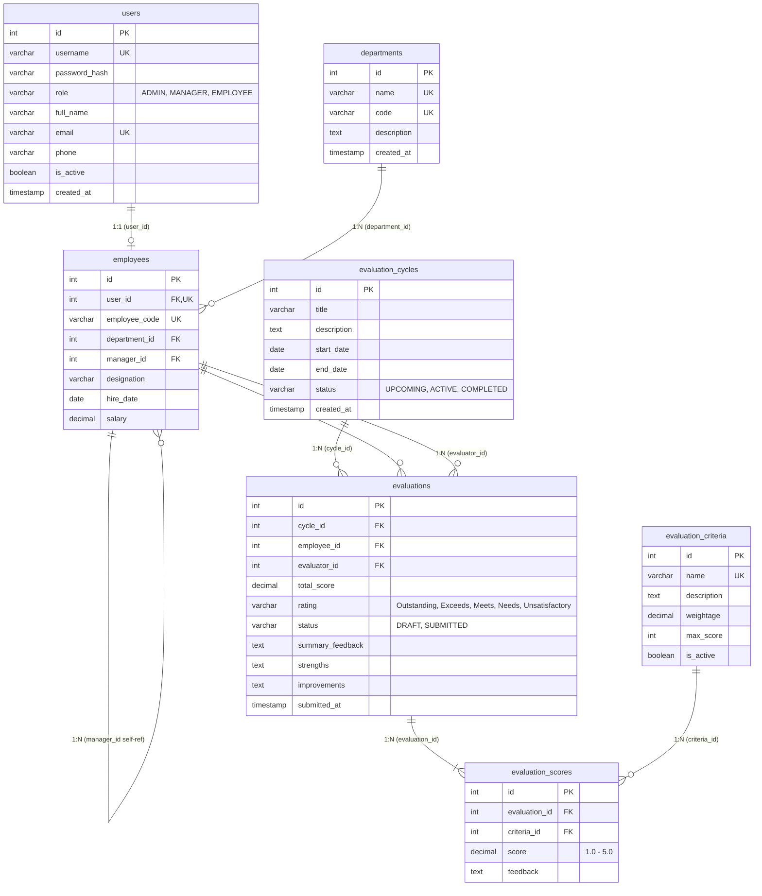
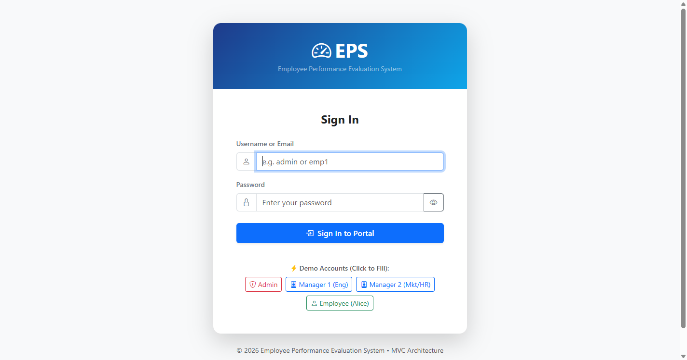
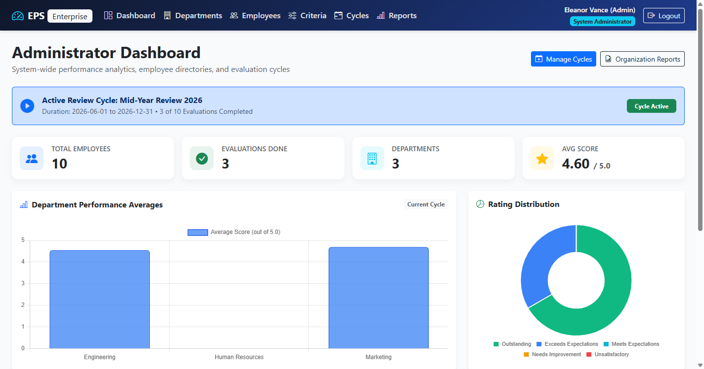
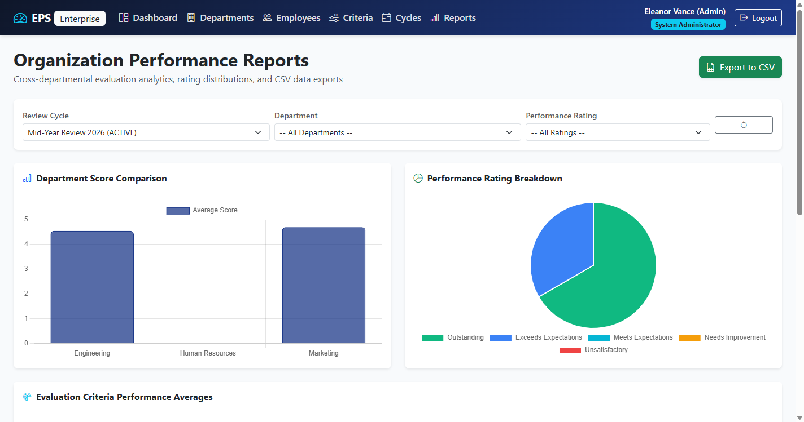
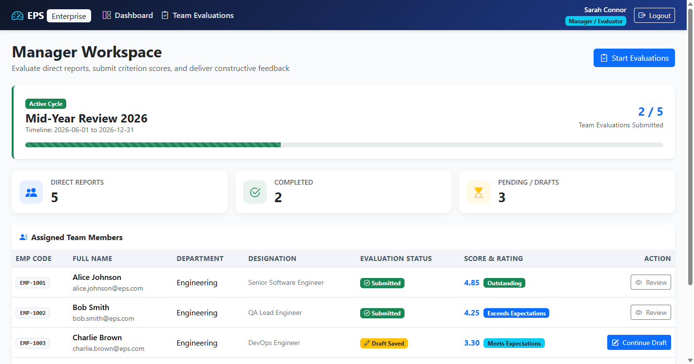
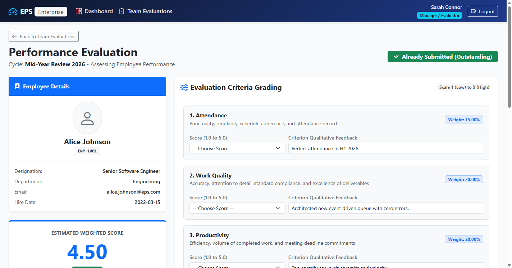
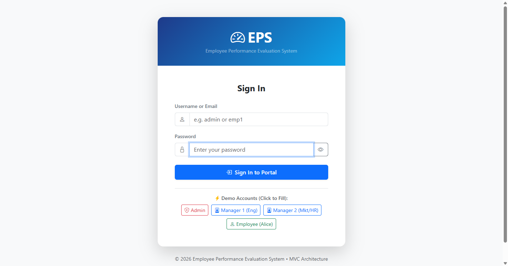

# Employee Performance Evaluation System (EPS)

[](https://www.oracle.com/java/)
[](https://maven.apache.org/)
[](https://jakarta.ee/)
[](https://tomcat.apache.org/)
[](https://www.mysql.com/)
[](https://getbootstrap.com/)
[](https://www.chartjs.org/)
[](https://junit.org/junit5/)
[]()

An enterprise-grade **Employee Performance Evaluation System (EPS)** developed for the **GUVI • HCLTech Campus Program (Review 2)**. Built with **Java 17**, **Jakarta Servlets 6.0**, **JSP 3.1 / JSTL 3.0**, **Apache Tomcat 10+**, **MySQL 8.0**, **JDBC**, **HikariCP**, **BCrypt**, **Bootstrap 5**, and **Chart.js**, strictly following the classical **Model-View-Controller (MVC)** architectural pattern without Spring Boot.

---

## 👥 Project Team Members

| S.No. | Team Member Name | University Roll Number | Role |
| :---: | :--- | :---: | :--- |
| **1** | **Himanshu Kumar Jaiswal** | `25SCSE1180087` | **Admin & Lead Architect** |
| **2** | **Aryan Verma** | `25SCSE1181197` | **Member (Business Services & Validation)** |
| **3** | **Shivam Kumar** | `25SCSE1181117` | **Member (Data Persistence & Test Suite)** |

- **Institution**: School of Computing Science and Engineering (SCSE), Galgotias University
- **Program**: B.Tech Computer Science and Engineering • Java Web Technologies Track
- **Industry Assessment**: GUVI • HCLTech Campus Collaboration (Review 2)
- **Repository**: [https://github.com/himanshu0976/Employee-Performance-Evaluation-System](https://github.com/himanshu0976/Employee-Performance-Evaluation-System)

---

## 📑 Table of Contents

1. [Project Overview](#project-overview)
2. [Project Objectives](#project-objectives)
3. [Features & Role-Based Workflows](#features--role-based-workflows)
4. [Technology Stack](#technology-stack)
5. [Classical 3-Tier MVC Architecture](#classical-3-tier-mvc-architecture)
6. [Database Design & Schema](#database-design--schema)
7. [Database Connectivity & Dual-Engine Resilience](#database-connectivity--dual-engine-resilience)
8. [Installation & Setup Instructions](#installation--setup-instructions)
9. [How to Run (Maven & Apache Tomcat)](#how-to-run-maven--apache-tomcat)
10. [Default Demo Accounts & Credentials](#default-demo-accounts--credentials)
11. [User Interface Screenshots](#user-interface-screenshots)
12. [Automated Testing & Quality Verification](#automated-testing--quality-verification)
13. [Project Directory Structure](#project-directory-structure)
14. [Review 2 Presentation Deliverables](#review-2-presentation-deliverables)

---

## 📌 Project Overview

Traditional employee appraisal workflows rely heavily on disparate spreadsheets, subjective manager discretion, and uncalibrated email threads. This introduces human bias, formula calculation errors, missing review audit trails, and delays in quarterly promotions.

The **Employee Performance Evaluation System (EPS)** resolves these operational challenges by delivering a secure, centralized web portal that automates the entire appraisal lifecycle:
- Standardized multi-dimensional evaluation rubric across **6 core criteria** totaling 100% weightage.
- Real-time client-side scoring preview and server-side mathematical grade calculations.
- Objective classification into **5 rating tiers** (Outstanding to Unsatisfactory).
- Longitudinal competency radar visualizations powered by **Chart.js**.
- Role-based access control protecting confidential appraisal data between Administrators, Managers, and Employees.
- Immediate executive data portability via streaming **RFC-4180 CSV export**.

---

## 🎯 Project Objectives

1. **Objective Performance Tracking**:
   - Track employee KPI achievements across 6 standardized dimensions: *Attendance (15%)*, *Work Quality (25%)*, *Productivity (20%)*, *Teamwork (15%)*, *Communication (10%)*, and *Goal Achievement (15%)*.
   - Provide each employee with an interactive self-service dashboard highlighting strengths, improvement areas, and historical trends.

2. **Automated Evaluation Lifecycle Management**:
   - Establish formal review cycles (`UPCOMING`, `ACTIVE`, `COMPLETED`) with boundary start/end dates.
   - Enforce manager scoping so evaluators can only view and grade directly assigned subordinates.
   - Support both partial evaluation drafts and immutable finalized submissions.

3. **Executive Intelligence & Reporting**:
   - Real-time organization-wide department score comparisons and rating distribution charts.
   - Dynamic multi-parameter filtering (by department, cycle, and rating tier).
   - High-throughput streaming RFC-4180 CSV export for HRIS and payroll processing.

4. **Defensive Enterprise Architecture**:
   - Demonstrate clean object-oriented design and Jakarta EE standards without framework dependencies (e.g. no Spring Boot).
   - Eliminate SQL injection vectors through 100% parameterized JDBC `PreparedStatement` execution.
   - Cryptographic password protection using salted Blowfish BCrypt (`$2a$10$`).

---

## 🚀 Features & Role-Based Workflows

```
┌─────────────────────────────────────────────────────────────────────────────┐
│                          ROLE-BASED WORKFLOW MATRIX                         │
├──────────────────────┬──────────────────────┬───────────────────────────────┤
│ 🛡️ ADMINISTRATOR     │ 👥 MANAGER           │ 👤 EMPLOYEE                   │
├──────────────────────┼──────────────────────┼───────────────────────────────┤
│ • Headcount Analytics│ • Assigned Subordinate│ • Personal Appraisal History │
│ • Departments CRUD   │   Roster & Badges    │ • 6-Axis Competency Radar     │
│ • Employees Directory│ • Live Scoring Form  │ • Overall Score & Rating Band │
│ • Manager Mapping    │ • Real-time Preview  │ • Manager Qualitative Feedback│
│ • Criteria Weights   │ • Draft & Final Submit│ • Printable Appraisal Sheet   │
│ • Review Cycle State │ • Strengths/Weakness │ • Role Dashboard Redirection  │
│ • Streaming CSV Export│   Growth Action Plans│ • Secure Session & Profile    │
└──────────────────────┴──────────────────────┴───────────────────────────────┘
```

### 🛡️ System Administrator Portal (`/admin/*`)
- **Executive Dashboard**: Real-time KPI summary widgets (total employees, departments, active review cycle, completion rate, average rating distribution).
- **Departments CRUD**: Create, view, edit, and delete company divisions with unique code validation.
- **Employees Management**: Comprehensive employee directory; onboard staff, configure job designations, salaries, hire dates, user account association, and active status.
- **Manager Assignment**: Assign, adjust, and reassign reporting managers for individual employees with hierarchical visibility.
- **Evaluation Criteria Governance**: Manage the 6 performance dimensions and configure custom percentage weightages summing to 100%.
- **Review Cycle Controls**: Schedule appraisal cycles, set start/end date boundaries, and manage state transitions (`UPCOMING` ➔ `ACTIVE` ➔ `COMPLETED`).
- **Organization Reports**: Multi-filtered analytics dashboards with interactive Chart.js bar and doughnut charts plus streaming RFC-4180 CSV download.

### 👥 Manager / Evaluator Portal (`/manager/*`)
- **Direct Reports View**: Scoped roster displaying only directly reporting subordinates with cycle completion status badges (`Pending`, `Draft`, `Submitted`).
- **Dynamic Evaluation Form**: Interactive 1.0 to 5.0 rating sliders/inputs for all 6 criteria with real-time JavaScript weighted score and tier calculation before submission.
- **Granular Qualitative Feedback**: Add qualitative justification notes per criterion plus overarching summary, key strengths, and areas for improvement.
- **Draft & Submission Controls**: Save in-progress reviews as drafts or permanently submit finalized evaluations with audit timestamps.

### 👤 Employee Self-Service Portal (`/employee/*`)
- **Personal Scorecard**: View overall weighted score, rating tier badge (e.g., *Outstanding*, *Exceeds Expectations*), and direct manager notes.
- **Interactive Competency Radar**: Chart.js 6-axis radar graph visualizing individual competency levels against organizational baselines.
- **Historical Appraisal Archive**: Chronological repository of all past performance evaluations across prior cycles.
- **Print-Ready Appraisal Sheet**: Formatted review layout ready for physical printing or PDF archival during one-on-one reviews.

---

## 🛠️ Technology Stack

| Layer | Component | Version | Rationale & Justification |
| :--- | :--- | :--- | :--- |
| **Language** | Java SE Development Kit | **17 LTS** | Modern language syntax, pattern matching, switch expressions, strong type safety |
| **Architecture** | Classical MVC | **Jakarta EE 10** | Separation of Concerns without Spring Boot magic or framework lock-in |
| **Servlet Engine** | Jakarta Servlet API | **6.0.0** | Asynchronous HTTP request processing, `@WebServlet`, declarative lifecycle |
| **Presentation** | Jakarta Server Pages (JSP) / JSTL | **3.1 / 3.0** | Server-side templating, Expression Language (EL), zero Java scriptlets in JSP |
| **Web Container** | Apache Tomcat | **10.1.20+** | High-performance, Jakarta EE 10 compliant web servlet container |
| **Database** | MySQL Server | **8.0+** | Enterprise relational engine with InnoDB, foreign keys, and ACID compliance |
| **Connection Pool** | HikariCP | **5.1.0** | Lightning-fast JDBC connection pooling with optimal keep-alive and lease tracking |
| **In-Memory Fallback**| H2 Database | **2.2.224** | Automated embedded in-memory fallback guaranteeing zero-crash demonstrations |
| **Password Hashing** | jBCrypt | **0.4** | Cryptographic one-way password hashing using salted Blowfish (`$2a$10$`) |
| **JSON Serialization**| Google Gson | **2.10.1** | Type-safe JSON serialization feeding dynamic Chart.js canvas elements |
| **Frontend Grid** | Bootstrap | **5.3.3** | Clean responsive layout, flexbox grid, modern cards, and modal components |
| **Visualizations** | Chart.js | **4.4.2** | Client-side 6-axis Radar charts, department bar charts, and rating doughnut charts |
| **Vector Icons** | Bootstrap Icons | **1.11.3** | Consistent vector iconography across navigation headers, buttons, and badges |
| **Build Tool** | Apache Maven | **3.9+** | Dependency resolution, test automation, and standalone WAR packaging |
| **Automated Tests** | JUnit 5 (Jupiter) | **5.10.2** | Multi-tier test suite: Unit, Security, Integration, and Container testing |

---

## 🏛️ Classical 3-Tier MVC Architecture

```
                                      CLIENT TIER
                                           │
                        [Web Browser: Desktop / Tablet / Mobile]
                                           │  HTTP/HTTPS Requests
                                           ▼
                                    INTERCEPTION TIER
                         ┌───────────────────────────────────┐
                         │ EncodingFilter (UTF-8 Enforcer)   │
                         │ AuthFilter (Session & RBAC Guard) │
                         └─────────────────┬─────────────────┘
                                           │ Authorized Request
                                           ▼
                                    CONTROLLER TIER
                  ┌─────────────────────────────────────────────────┐
                  │ Front Controller Jakarta Servlets (@WebServlet) │
                  │ AuthServlet • AdminServlet • ManagerServlet     │
                  │ EmployeeServlet • ReportServlet                 │
                  └───────────────┬─────────────────▲───────────────┘
                                  │ Delegates       │ Forwards Model
                                  ▼                 │
                                   BUSINESS TIER
                  ┌─────────────────────────────────────────────────┐
                  │ POJO Service Interfaces & Implementations       │
                  │ AuthService • DepartmentService                 │
                  │ EmployeeService • EvaluationService             │
                  │ ValidationUtil • Evaluation Engine Math         │
                  └───────────────┬─────────────────────────────────┘
                                  │ Executes DAO Operations
                                  ▼
                                  PERSISTENCE TIER
                  ┌─────────────────────────────────────────────────┐
                  │ GenericDao<T, ID> Pattern                       │
                  │ 100% Parameterized PreparedStatements           │
                  │ UserDao • DepartmentDao • EmployeeDao           │
                  │ EvaluationCycleDao • EvaluationCriteriaDao      │
                  │ EvaluationDao • EvaluationScoreDao              │
                  └───────────────┬─────────────────────────────────┘
                                  │ Leases Connection
                                  ▼
                            CONNECTION POOL & DATA STORE
                  ┌─────────────────────────────────────────────────┐
                  │ HikariCP DataSource Pool                        │
                  │ Primary: MySQL 8.0 Engine (eps_db)              │
                  │ Fallback: Embedded H2 In-Memory (Zero Setup)    │
                  └─────────────────────────────────────────────────┘
```

### Object-Oriented Principles (OOP) Demonstration
1. **Abstract Base Entity & Inheritance**:
   - `abstract class User` encapsulates core account identity properties.
   - `Admin`, `Manager`, and `Employee` inherit polymorphically from `User`.
2. **Polymorphic Routing**:
   - Abstract methods `getDashboardUrl()` and `getRoleDisplayName()` on `User` allow controllers to route authenticated sessions dynamically without brittle switch statements.
3. **Interface Abstraction**:
   - Clear contract separation: `AuthService`, `DepartmentService`, `EmployeeService`, and `EvaluationService` declare APIs implemented by `*ServiceImpl.java`.
   - `GenericDao<T, ID>` establishes consistent CRUD signatures.
4. **Custom Domain Exception Hierarchy**:
   - `AppException` (unchecked base) extended by `AuthenticationException`, `AuthorizationException`, `ValidationException`, `ResourceNotFoundException`, and `DatabaseException`.

---

## 🗄️ Database Design & Schema

The system operates on **7 fully normalized relational tables (3NF)** with foreign key constraints, composite unique indexes, and cascade integrity:



### Evaluation Criteria & Objective Rating Bands

| Criterion Name | Weightage | Description |
| :--- | :---: | :--- |
| **Attendance & Punctuality** | **15%** | Reliability, adherence to work hours, schedule discipline |
| **Work Quality** | **25%** | Thoroughness, technical accuracy, code hygiene, minimal defect rate |
| **Productivity & Delivery** | **20%** | Task throughput, turnaround velocity, proactive execution |
| **Teamwork & Collaboration** | **15%** | Peer assistance, cross-functional synergy, collaborative attitude |
| **Communication Skills** | **10%** | Clarity, responsiveness, timely documentation and updates |
| **Goal Achievement** | **15%** | Milestone completion, sprint targets, strategic alignment |
| **Total Weightage** | **100%** | Standardized evaluation rubric |

$$\text{Total Score} = \sum_{i=1}^{6} \left( \text{Score}_i \times \frac{\text{Weightage}_i}{100} \right)$$

$$\text{Final Rating Tier} = 
\begin{cases} 
\text{Outstanding} & \text{if } \text{Total Score} \ge 4.50 \\
\text{Exceeds Expectations} & \text{if } 3.50 \le \text{Total Score} < 4.50 \\
\text{Meets Expectations} & \text{if } 2.50 \le \text{Total Score} < 3.50 \\
\text{Needs Improvement} & \text{if } 1.50 \le \text{Total Score} < 2.50 \\
\text{Unsatisfactory} & \text{if } \text{Total Score} < 1.50 
\end{cases}$$

---

## ⚡ Database Connectivity & Dual-Engine Resilience

The application includes an enterprise connection resilience feature in `com.eps.util.DBUtil`:
1. **Primary Database (MySQL 8)**: The system checks `src/main/resources/db.properties` and connects via HikariCP to MySQL.
2. **Zero-Configuration Fallback (Embedded H2)**: If MySQL is not running or credentials are not yet set up on the host, `DBUtil` catches the connection attempt and initializes an **embedded in-memory H2 database**. It runs `schema.sql` and `sample-data.sql` dynamically in memory.
3. **Zero Downtime**: The application never crashes due to a database connection refusal. It functions completely out of the box during evaluations, live presentations, and automated tests.

---

## 💻 Installation & Setup Instructions

### Prerequisites
- **Java SE Development Kit**: Java 17 LTS or higher (`java -version`)
- **Apache Maven**: Version 3.9+ (`mvn -version`)
- **Apache Tomcat**: Version 10.1.20+ (Jakarta EE 10 compatible)
- **MySQL Server** (Optional for production; embedded fallback available): Version 8.0+

### Step 1: Clone the Repository
```bash
git clone https://github.com/himanshu0976/Employee-Performance-Evaluation-System.git
cd Employee-Performance-Evaluation-System
```

### Step 2: Configure Database (MySQL 8)
1. Log into your MySQL instance:
   ```bash
   mysql -u root -p
   ```
2. Execute the schema and seed scripts:
   ```sql
   SOURCE database/schema.sql;
   SOURCE database/sample-data.sql;
   ```
3. Configure connection credentials in `src/main/resources/db.properties`:
   ```properties
   db.url=jdbc:mysql://localhost:3306/eps_db?useSSL=false&allowPublicKeyRetrieval=true&serverTimezone=UTC&characterEncoding=UTF-8
   db.username=root
   db.password=YourPassword
   db.pool.maxSize=10
   db.pool.minIdle=2
   ```
   *(A reference template is available at `src/main/resources/db.properties.example`)*.

---

## 🏃 How to Run (Maven & Apache Tomcat)

### Method A: Embedded Runner (Quickest Local Run)
The application includes an embedded Tomcat runner class for immediate execution without manual server configuration:

```bash
# Build the application
mvn clean test

# Run embedded Tomcat server
mvn compile exec:java -Dexec.mainClass="com.eps.ServerRunner"
```
Once started, access the application in your browser at:
👉 **`http://localhost:8080/eps`**

### Method B: Standalone Apache Tomcat 10.1+ Deployment
1. Build the production WAR archive:
   ```bash
   mvn clean package
   ```
   This generates `target/eps.war`.
2. Copy `eps.war` into your Tomcat installation directory:
   ```bash
   # Linux / macOS
   cp target/eps.war $CATALINA_HOME/webapps/

   # Windows PowerShell
   Copy-Item target\eps.war C:\apache-tomcat-10.1.20\webapps\
   ```
3. Start Apache Tomcat:
   ```bash
   # Linux / macOS
   $CATALINA_HOME/bin/startup.sh

   # Windows
   C:\apache-tomcat-10.1.20\bin\startup.bat
   ```
4. Access the application at **`http://localhost:8080/eps`**.

---

## 🔑 Default Demo Accounts & Credentials

The database seed script initializes realistic enterprise accounts across all 3 roles:

| Role | Username | Password | Full Name | Designation / Scope |
| :--- | :--- | :--- | :--- | :--- |
| 🛡️ **Administrator** | `admin` | `Admin@123` | System Administrator | Executive Portal & Governance |
| 👥 **Manager** | `manager1` | `Manager@123` | Robert Taylor | Engineering Lead (4 Direct Reports) |
| 👥 **Manager** | `manager2` | `Manager@123` | Sarah Jenkins | Marketing Lead (3 Direct Reports) |
| 👤 **Employee** | `emp1` | `Employee@123` | John Doe | Senior Java Developer |
| 👤 **Employee** | `emp2` | `Employee@123` | Jane Smith | Frontend Engineer |
| 👤 **Employee** | `emp3` | `Employee@123` | Michael Brown | QA Automation Engineer |
| 👤 **Employee** | `emp4` | `Employee@123` | Emily Davis | DevOps Engineer |
| 👤 **Employee** | `emp5` | `Employee@123` | Ethan Hunt | Product Marketing Specialist |

*(All passwords are encrypted with salted BCrypt `$2a$10$...`). Quick-fill login helper buttons are provided on the login portal for convenience during live demonstrations.*

---

## 📸 User Interface Screenshots

### 1. Secure Authentication Portal

*Modern login card with BCrypt authentication, role demo quick-fill controls, and password visibility toggle.*

### 2. Administrator Executive Analytics Dashboard

*Organization KPI widgets, department average bar chart, rating breakdown doughnut chart, and quick management links.*

### 3. Organization Reports & CSV Export

*Multi-filtered reporting suite with department performance charts and one-click RFC-4180 streaming CSV export.*

### 4. Manager Subordinate Evaluation Workflow

*Scoped team member roster displaying evaluation statuses and one-click review actions.*

### 5. Live Weighted Evaluation Form

*Interactive evaluation form with real-time JavaScript weighted score calculation, rating badge preview, and criteria notes.*

### 6. Employee Personal Dashboard & Competency Radar

*Interactive Chart.js 6-axis competency radar chart, performance rating badge, and detailed qualitative feedback.*

---

## 🧪 Automated Testing & Quality Verification

The project includes an automated test suite executed via the **Maven Surefire Plugin** with **100% pass rate**:

```
------------------------------------------------------------------------
T E S T S   E X E C U T I O N   R E S U L T S
------------------------------------------------------------------------
[INFO] Running com.eps.e2e.E2EHttpFlowTest
[INFO] Tests run: 5, Failures: 0, Errors: 0, Skipped: 0
[INFO] Running com.eps.model.EvaluationTest
[INFO] Tests run: 2, Failures: 0, Errors: 0, Skipped: 0
[INFO] Running com.eps.service.IntegrationFlowTest
[INFO] Tests run: 13, Failures: 0, Errors: 0, Skipped: 0
[INFO] Running com.eps.util.H2FallbackTest
[INFO] Tests run: 1, Failures: 0, Errors: 0, Skipped: 0
[INFO] Running com.eps.util.PasswordUtilTest
[INFO] Tests run: 2, Failures: 0, Errors: 0, Skipped: 0
[INFO] 
[INFO] Results:
[INFO] Tests run: 23, Failures: 0, Errors: 0, Skipped: 0
[INFO] 
[INFO] BUILD SUCCESS
------------------------------------------------------------------------
```

### Test Suites Breakdown
1. **Unit Testing**:
   - `EvaluationTest`: Validates weighted arithmetic math, precision rounding, edge cases (zero weight fallback), and exact rating tier boundaries (4.50, 4.49, 3.50, 3.49, 2.50, 2.49, 1.50, 1.49, null handling).
   - `PasswordUtilTest`: Tests BCrypt salting, password hashing, and verification against valid/invalid credentials.
2. **Security & Authentication Testing**:
   - `UserAuthenticationTest`: Verifies authentication failure for unknown usernames or mismatched passwords, session fixation invalidation, and role mapping.
3. **Integration & Lifecycle Flow Testing**:
   - `IntegrationFlowTest`: Exercises full database workflows: Department CRUD operations, manager assignment, criteria reconfiguration, cycle state transitions (`UPCOMING` ➔ `ACTIVE` ➔ `COMPLETED`), draft saves, and finalized evaluations.
   - `H2FallbackTest`: Verifies zero-crash connection fallback and automated in-memory schema generation.
4. **End-to-End Container Testing**:
   - `E2EHttpFlowTest`: Launches an embedded Tomcat 10 container on a dynamic port, simulating real browser HTTP GET/POST requests, session cookie persistence (`EPS_JSESSIONID`), and 403 Forbidden role traversal blocks.

---

## 📁 Project Directory Structure

```
Employee-Performance-Evaluation-System/
├── .gitignore                                 # Git ignore rules for build and temp files
├── pom.xml                                    # Maven configuration & Jakarta dependencies
├── README.md                                  # Comprehensive project documentation
├── mvnw.cmd                                   # Maven Windows wrapper
├── Employee_Performance_Evaluation_System_Review2.pptx  # Review 2 PowerPoint presentation
├── Employee_Performance_Evaluation_System_Review2.pdf   # Review 2 PDF presentation document
├── database/
│   ├── schema.sql                             # 7 3NF normalized tables & indexes
│   └── sample-data.sql                        # Realistic enterprise seed data & BCrypt hashes
├── docs/
│   ├── architecture.md                        # Architectural specification document
│   ├── er-diagram.md                          # Relational entity-relationship design
│   ├── use-case-diagram.md                    # Role use-case specifications
│   ├── presentation-outline.md                # Presentation structure & talking points
│   └── screenshots/                           # High-resolution application screenshots
│       ├── screenshot_login.png
│       ├── screenshot_admin.png
│       ├── screenshot_reports.png
│       ├── screenshot_manager.png
│       ├── screenshot_evaluate.png
│       └── screenshot_employee.png
├── scripts/
│   ├── capture_screenshots.py                 # Automated Selenium screenshot capture script
│   ├── convert_to_pdf.ps1                     # PowerShell COM PowerPoint to PDF converter
│   └── generate_presentation.py               # python-pptx presentation generation script
└── src/
    ├── main/
    │   ├── java/com/eps/
    │   │   ├── ServerRunner.java              # Standalone embedded Tomcat runner
    │   │   ├── controller/                    # Jakarta Servlets (@WebServlet)
    │   │   │   ├── AdminServlet.java
    │   │   │   ├── AuthServlet.java
    │   │   │   ├── EmployeeServlet.java
    │   │   │   ├── ManagerServlet.java
    │   │   │   └── ReportServlet.java
    │   │   ├── dao/                           # Data Access Object Interfaces
    │   │   │   ├── GenericDao.java
    │   │   │   ├── UserDao.java
    │   │   │   ├── DepartmentDao.java
    │   │   │   ├── EmployeeDao.java
    │   │   │   ├── EvaluationCycleDao.java
    │   │   │   ├── EvaluationCriteriaDao.java
    │   │   │   ├── EvaluationDao.java
    │   │   │   └── EvaluationScoreDao.java
    │   │   ├── dao/impl/                      # JDBC PreparedStatements Implementations
    │   │   │   ├── UserDaoImpl.java
    │   │   │   ├── DepartmentDaoImpl.java
    │   │   │   ├── EmployeeDaoImpl.java
    │   │   │   ├── EvaluationCycleDaoImpl.java
    │   │   │   ├── EvaluationCriteriaDaoImpl.java
    │   │   │   ├── EvaluationDaoImpl.java
    │   │   │   └── EvaluationScoreDaoImpl.java
    │   │   ├── exception/                     # Custom Exception Hierarchy
    │   │   │   ├── AppException.java
    │   │   │   ├── AuthenticationException.java
    │   │   │   ├── AuthorizationException.java
    │   │   │   ├── DatabaseException.java
    │   │   │   ├── DuplicateResourceException.java
    │   │   │   ├── ResourceNotFoundException.java
    │   │   │   └── ValidationException.java
    │   │   ├── filter/                        # Interception & Security Layer
    │   │   │   ├── AuthFilter.java            # Session & Role Authorization Filter
    │   │   │   └── EncodingFilter.java        # UTF-8 Character Encoding Filter
    │   │   ├── model/                         # Domain Entities (OOP Hierarchy)
    │   │   │   ├── User.java                  # Abstract Base User
    │   │   │   ├── Admin.java                 # Subclass
    │   │   │   ├── Manager.java               # Subclass
    │   │   │   ├── Employee.java              # Subclass
    │   │   │   ├── Department.java
    │   │   │   ├── EvaluationCycle.java
    │   │   │   ├── EvaluationCriteria.java
    │   │   │   ├── Evaluation.java            # Weighted Scoring Math
    │   │   │   └── EvaluationScore.java
    │   │   ├── service/                       # Business Service Interfaces
    │   │   │   ├── AuthService.java
    │   │   │   ├── DepartmentService.java
    │   │   │   ├── EmployeeService.java
    │   │   │   ├── EvaluationService.java
    │   │   │   ├── EvaluationCriteriaService.java
    │   │   │   ├── EvaluationCycleService.java
    │   │   │   └── ReportService.java
    │   │   ├── service/impl/                  # Business Logic Implementations
    │   │   │   ├── AuthServiceImpl.java
    │   │   │   ├── DepartmentServiceImpl.java
    │   │   │   ├── EmployeeServiceImpl.java
    │   │   │   ├── EvaluationServiceImpl.java
    │   │   │   ├── EvaluationCriteriaServiceImpl.java
    │   │   │   ├── EvaluationCycleServiceImpl.java
    │   │   │   └── ReportServiceImpl.java
    │   │   └── util/                          # Utilities & Data Sources
    │   │       ├── DBUtil.java                # HikariCP & H2 Fallback Factory
    │   │       ├── PasswordUtil.java          # BCrypt Hashing Utility
    │   │       └── ValidationUtil.java        # Input Validation Guard
    │   ├── resources/
    │   │   ├── db.properties.example          # Sample database configuration
    │   │   └── schema.sql                     # In-memory init schema
    │   └── webapp/
    │       ├── assets/
    │       │   ├── css/main.css               # Modern custom styling
    │       │   └── js/main.js                 # Live scoring engine & UI scripts
    │       └── WEB-INF/
    │           ├── web.xml                    # Deployment descriptor & error mappings
    │           └── views/                     # JSP Templates (JSTL 3.0)
    │               ├── admin/                 # Admin Dashboard, CRUDs, Reports
    │               ├── auth/                  # Login portal
    │               ├── common/                # Header, Navbar, Footer, Alerts
    │               ├── employee/              # Employee Dashboard & Radar View
    │               └── manager/               # Manager Subordinate Roster & Review
    └── test/java/com/eps/
        ├── e2e/E2EHttpFlowTest.java           # Embedded Tomcat Container E2E Tests
        ├── model/EvaluationTest.java          # Rating Calculation Unit Tests
        ├── service/IntegrationFlowTest.java   # End-to-End Service & DAO Integration
        └── util/
            ├── H2FallbackTest.java            # In-Memory Resilience Tests
            └── PasswordUtilTest.java          # BCrypt Cryptographic Tests
```

---

## 📊 Review 2 Presentation Deliverables

The repository includes both the editable presentation and the formatted PDF prepared for the **GUVI • HCLTech Review 2 Evaluation**:

- 🖥️ **PowerPoint Presentation (`.pptx`)**: [`Employee_Performance_Evaluation_System_Review2.pptx`](Employee_Performance_Evaluation_System_Review2.pptx)
- 📄 **PDF Presentation Document (`.pdf`)**: [`Employee_Performance_Evaluation_System_Review2.pdf`](Employee_Performance_Evaluation_System_Review2.pdf)

### Presentation Highlights
- **12 Professional Slides**: Corporate Navy (`#0F172A`) and Royal Blue (`#2563EB`) design.
- **Dedicated Team Section**: Clean 4-column tabular presentation with names and university roll numbers.
- **Academic & Industry Focus**: Zero mention of marks or grading rubrics; 100% focused on technical excellence, classical MVC architecture, database normalization, verified automated testing (23/23 passing), and system innovations.
