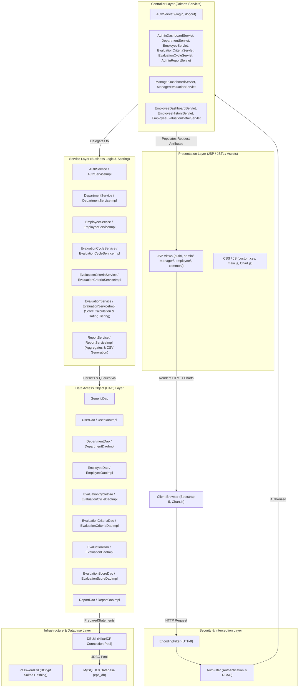

# Architecture & Object-Oriented Design (OOP) Documentation

## System Architecture

The Employee Performance Evaluation System (EPS) is built adhering strictly to the classical **Model-View-Controller (MVC)** architectural pattern using **Jakarta EE 10 Servlets**, **JSP / JSTL**, and **JDBC** without Spring Boot.

---

## Object-Oriented Programming (OOP) Demonstration

### 1. Abstract Classes & Inheritance
- **`abstract class User`**: Defines universal user entity identity: `id`, `username`, `passwordHash`, `role`, `fullName`, `email`, `phone`, `active`, `createdAt`.
- **Subclasses**:
  - `Admin extends User` &rarr; Encapsulates admin dashboard URLs (`/admin/dashboard`) and admin-specific actions.
  - `Manager extends User` &rarr; Encapsulates evaluator identity, department links, direct reports count, and manager navigation.
  - `Employee extends User` &rarr; Encapsulates employment details (code, designation, hire date, salary, reporting manager).

### 2. Polymorphism & Interface Abstraction
- The abstract method `getDashboardUrl()` and `getRoleDisplayName()` on `User` is overridden polymorphically by `Admin`, `Manager`, and `Employee`. When a user logs in, `AuthFilter` and `AuthServlet` dispatch to `user.getDashboardUrl()` dynamically without instanceof branching.
- **DAO Interfaces**: `UserDao`, `DepartmentDao`, `EmployeeDao`, `EvaluationDao`, `EvaluationCriteriaDao`, etc., decouple contract from implementation, allowing test mocks or alternative storage engines.
- **Service Interfaces**: `AuthService`, `DepartmentService`, `EmployeeService`, `EvaluationService`, `ReportService` separate presentation controller logic from business rules.

### 3. Generics and Collections
- `GenericDao<T, ID>` demonstrates Java Generics (`T` for entity, `ID` for key type), providing reusable `findById`, `findAll`, `save`, `update`, and `deleteById` signatures.
- Type-safe collections (`List<EvaluationScore>`, `Map<String, Integer>`, `Optional<T>`) ensure high code safety and readability without raw types.

### 4. Encapsulation & Domain Invariants
- Private and protected member variables with validated getters and setters.
- Domain calculation methods: `Evaluation.calculateTotalScoreAndRating()` encapsulates the weighted average formula:
  $$\text{Total Score} = \frac{\sum_{i=1}^{n} (\text{score}_i \times \text{weight}_i)}{\sum_{i=1}^{n} \text{weight}_i}$$
  and determines the rating category based on system rating scale:
  - `[4.50, 5.00]` &rarr; **Outstanding**
  - `[3.50, 4.49]` &rarr; **Exceeds Expectations**
  - `[2.50, 3.49]` &rarr; **Meets Expectations**
  - `[1.50, 2.49]` &rarr; **Needs Improvement**
  - `[0.00, 1.49]` &rarr; **Unsatisfactory**

### 5. Custom Exception Hierarchy
- Base unchecked exception `AppException` extends `RuntimeException` carrying an HTTP status code.
- Specific domain exceptions:
  - `AuthenticationException` (401)
  - `AuthorizationException` (403)
  - `ValidationException` (400)
  - `ResourceNotFoundException` (404)
  - `DuplicateResourceException` (409)
  - `DatabaseException` (500)

### 6. SQL Injection Prevention & Connection Pooling
- 100% of SQL statements across all DAOs use parameterized `PreparedStatement`.
- High-performance connection pooling via **HikariCP** (`HikariDataSource`) with parameter caching.
