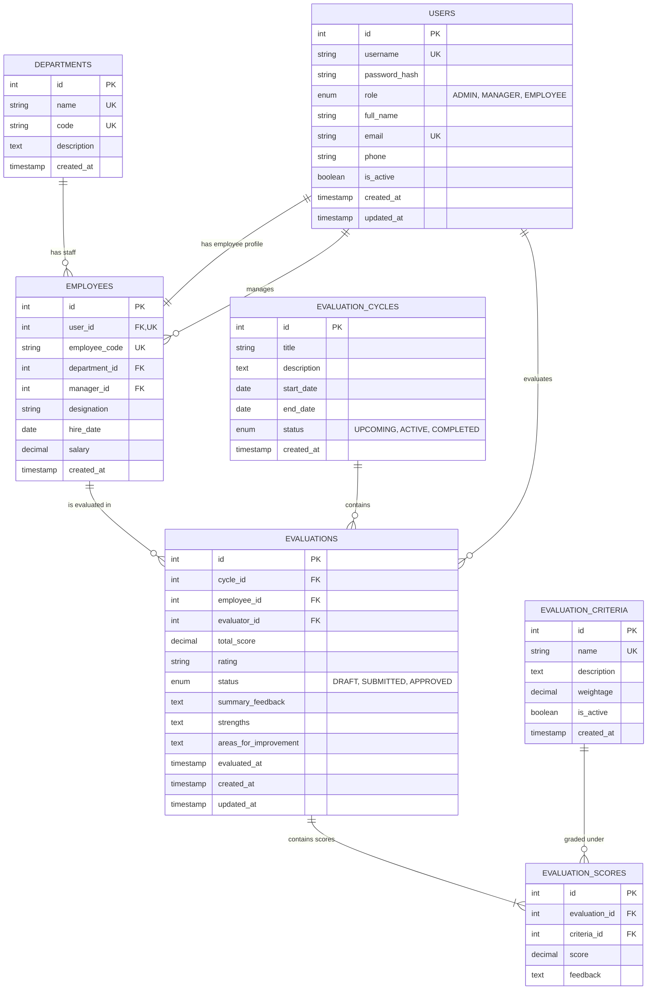

# Entity-Relationship (ER) Diagram

## Database Schema Model
The EPS persistence model is normalized in 3NF with foreign keys and cascade rules for relational integrity.

---

## Table Relationships & Cardinality

1. **`users` &rarr; `employees` (1 : 1)**
   - Every employee has a corresponding user record containing login credentials (`user_id`).
2. **`departments` &rarr; `employees` (1 : N)**
   - A department can house multiple employees. If a department is deleted, employee department is set to NULL.
3. **`users` (Manager) &rarr; `employees` (1 : N)**
   - A manager manages multiple employees (`manager_id` references `users.id`).
4. **`evaluation_cycles` &rarr; `evaluations` (1 : N)**
   - A cycle groups all reviews for a designated period (e.g. Annual 2025, Mid-Year 2026).
5. **`employees` &rarr; `evaluations` (1 : N)**
   - An employee has at most one evaluation per review cycle (`UNIQUE(cycle_id, employee_id)`).
6. **`evaluations` &rarr; `evaluation_scores` (1 : N)**
   - An evaluation contains score entries for active criteria (`Attendance`, `Work Quality`, `Productivity`, `Teamwork`, `Communication`, `Goal Achievement`).
7. **`evaluation_criteria` &rarr; `evaluation_scores` (1 : N)**
   - Each score line item is tied to a specific criterion dimension and weightage.
