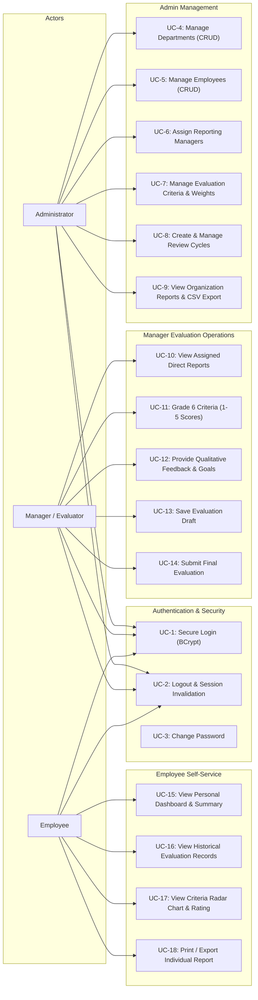

# Use Case Diagram & Actor Specifications

## Overview
The Employee Performance Evaluation System (EPS) is governed by three primary actors:
1. **System Administrator (Admin)**
2. **Manager (Evaluator)**
3. **Employee (Subject of Evaluation)**

---

## Mermaid Use Case Diagram

---

## Actor Responsibilities & Use Case Specifications

| Use Case ID | Name | Actor | Description | Preconditions |
|---|---|---|---|---|
| **UC-1** | Secure Login | All | Authenticate via username/email and BCrypt verified password | Active account |
| **UC-4** | Departments CRUD | Admin | Create, read, update, and delete organizational departments | Admin logged in |
| **UC-5** | Employees CRUD | Admin | Register new employees, set passwords, salaries, and details | Admin logged in |
| **UC-6** | Assign Managers | Admin | Map employees to specific managers | Active manager accounts |
| **UC-7** | Manage Criteria | Admin | Configure the 6 criteria (Attendance, Quality, Productivity, Teamwork, Communication, Goals) and weights | Admin logged in |
| **UC-8** | Manage Cycles | Admin | Open new review cycles, set dates, toggle UPCOMING/ACTIVE/COMPLETED | Admin logged in |
| **UC-9** | Org Reports & Export | Admin | View real-time charts and export filtered reports to CSV | Admin logged in |
| **UC-10** | View Direct Reports | Manager | Access list of assigned employees and their review status | Active review cycle |
| **UC-11** | Grade Criteria | Manager | Assign scores (1.0 - 5.0) for each criterion with weightage | Review cycle is ACTIVE |
| **UC-13** | Save Draft | Manager | Store partial score and feedback without finalizing rating | In progress review |
| **UC-14** | Submit Evaluation | Manager | Compute weighted score, assign rating tier, and submit | All criteria scored |
| **UC-15** | View Dashboard | Employee | Inspect latest evaluation score, rating badge, and competencies | Employee logged in |
| **UC-16** | View History | Employee | Browse historical reviews across all previous cycles | Previous reviews exist |
| **UC-17** | View Radar Chart | Employee | Analyze radar chart visual of criteria strengths & weaknesses | Submitted review exists |
| **UC-18** | Print Report | Employee | Generate print-friendly PDF / paper review summary | Completed review |
